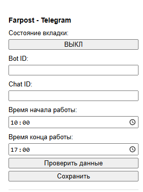
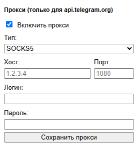

# Farpost-Telegram Parser
[[Версия на русском языке]](README.ru.md)  
A Chrome extension that automatically refreshes the Farpost page and sends a Telegram message if a new listing appears.  
Works only on Subscriptions pages ("Подписки") with  new listings from, sorted by date.

# Visual Demonstration
  

# Instructions
To use the extension, follow these instructions:  

### Install a Chrome Extension from a ZIP File.
1. Extract the ZIP file to a folder on your computer.
2. Open Chrome and go to `chrome://extensions`.
3. Turn on Developer mode in the top-right corner.
4. Click `Load unpacked`.
5. Select the extracted extension folder (the folder containing manifest.json).
6. The extension will now appear in Chrome and is ready to use.

### Create a Telegram Bot.
1. Open Telegram and search for `@BotFather`.
2. Start a chat with BotFather and send `/newbot`.
3. Enter a name for your bot, for example: My Test Bot.
4. Choose a username for your bot.
5. BotFather will create the bot and send you an HTTP API `token`.
6. Copy and save this token securely. Do not share it publicly, because anyone who has the token can control your bot.

### Get your user ID in Telegram
1. Open Telegram and search for `@userinfobot`.
2. Start the bot by clicking Start.
3. It will reply with information including your numeric User ID.

### Configure the extension
1. Open the extension in the top right corner (a window like the one shown in the screenshots should appear).  
2. Copy the bot token into `BotID` and your ID into `ChatID`.  
3. Configure everything else according to your preferences, and be sure to click "Save" ("Сохранить").  

### Final steps
1. Open the Farpost subscriptions page.  
2. In the `"Tab status"` (`"Состояние вкладки"`) field, click it so that the status changes to `"Enabled"` (`"ВКЛ"`).  

✅ Done! When new listings appear, you will receive a message on Telegram.
